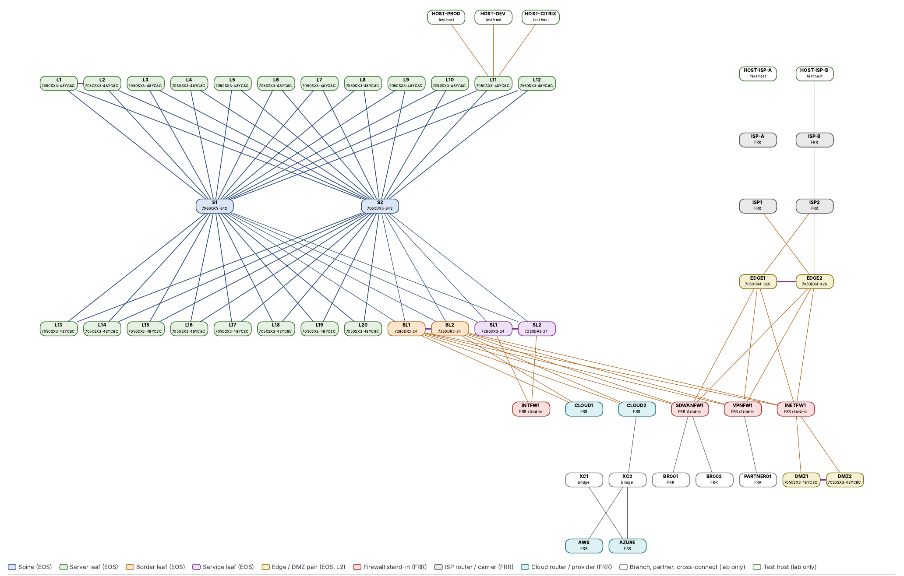

# infrahub-arista-dc

I built this to run a whole datacenter network as code. DC3 is an Arista EOS EVPN/VXLAN fabric with 2 spines and 28
leaves, plus FRR containers standing in for the firewalls, ISPs and clouds around it.

Everything starts in Infrahub. A generator turns the design into devices, links and IP addresses, and Jinja2 templates
turn that into the switch configs. I don't edit configs by hand: if something has to change, it changes in the data.
The lab runs in containerlab with cEOS-lab, and Infrahub itself comes up from one compose file, so the whole thing can
be rebuilt from an empty machine.

## Where it stands

The full lab is 30 switches and 22 FRR nodes. On the last full run all 1525 pre-checks passed, and all 30 switches
provisioned themselves with ZTP in 425 seconds. 15 of the 16 failure tests pass; test 6 is still open. A smaller
6-node version runs on a 16 GB laptop, and 135 unit tests run on every push.

## What's in it

- The fabric: one MLAG server-leaf pair, EVPN ESI pairs L3-L10, single leaves L11-L20, and border, service, edge and
  DMZ pairs. eBGP underlay with BFD, EVPN overlay, an anycast gateway and five tenant VRFs.
- The edge: internal and internet firewalls, an SD-WAN hub with two branches, a VPN partner, two ISPs, and AWS and
  Azure, all as FRR containers.
- ZTP: a blank switch gets an address from DHCP, pulls its config from Infrahub, reboots, and gets checked over eAPI.
- The rendered config of every device, in [`tests/expected/`](tests/expected).
- A 17-page set of diagrams, in [`docs/diagrams/DC3-diagrams.pdf`](docs/diagrams/DC3-diagrams.pdf).

## Try it

[docs/QUICKSTART.md](docs/QUICKSTART.md) takes you from an empty Ubuntu machine (Linux, or Windows with WSL2) to a
running fabric. The 6-node lab needs a 16 GB laptop; the full lab needs a 64 GB Linux host. More detail is in
[docs/BUILD.md](docs/BUILD.md) (every build step) and [docs/DESIGN.md](docs/DESIGN.md) (the design on one page).

## Repository map

| Path | What it holds |
|---|---|
| `docs/QUICKSTART.md` | from an empty Ubuntu (Linux or WSL2) to a running, clickable lab: tools, images, Infrahub, renders, smoke or full lab, ZTP |
| `docs/DESIGN.md` | the design as built (topology, numbering, underlay, MLAG, overlay, tenants, pipeline, verification) |
| `docs/LAB-GUI.md` | clickable lab topology (containerlab VS Code extension): log in to any device, stop, start or restart it; `lab/dc3_lifecycle_test.sh` is written for it, but its scripted tests are not run yet |
| `docs/diagrams/DC3-diagrams.pdf` | 17-page A3 diagram set drawn from the renders: physical, spine-leaf links, underlay, overlay, EVPN route types, packet walks, MLAG, firewall and outside attachments, edge, VRF paths, policy, segments, management and ZTP, lab and tests (`scripts/dc3_diagrams.py`) |
| `docs/VXLAN-EVPN-CAPTURE.md` | how the control plane and data plane work, with captured packets |
| `ztp/` | zero-touch provisioning of the 30 switches from Infrahub (`ztp/README.md`) |
| `docs/BUILD.md` | the build, step by step: prerequisites, Infrahub, schema, objects, pools, generator, renders, lab, failure tests, teardown |
| `docker-compose.yml`, `.env.example` | the Infrahub 1.11.2 stack (compose project `infrahub-arista-dc`, host ports from `.env`, no built-in secrets) |
| `pyproject.toml`, `infrahubctl.toml.example` | the uv environment (`infrahub-sdk[ctl]==1.23.2`), infrahubctl settings |
| `schemas/`, `schemas-dc3/` | the Infrahub schema; `schemas-dc3/ztp.yml` adds the ZTP state fields |
| `objects/` | the DC3 data, loaded in file-name order; `dc3-01-bootstrap.yml` holds the shared objects DC3 references |
| `generators/` | generator `dc3_site` (`dc3_site.py`) and its pure-Python plan (`dc3_plan.py`) |
| `queries/`, `templates/`, `.infrahub.yml` | GraphQL queries, Jinja2 templates, transforms, artifact and generator definitions |
| `scripts/` | `bootstrap.sh` (build steps 4–10), `dc3_guard.py` (DC3-only instance guard), `dc3_create_pools.py`, `dc3_id_snapshot.py`, `dc3_render_diff.py`, `dc3_lab_topology.py` |
| `lab/` | containerlab topologies, cEOS interface mapping, render check, post-check, failure tests, smoke test |
| `tests/` | offline tests (no Infrahub, no Docker); `tests/expected/` = the 43 reference renders, `tests/expected-delta.diff` = the recorded changes since them (empty: `tests/expected` matches the current templates) |
| `plans/dc3-values.md` | all DC3 values in one page |

## License

MIT, see LICENSE.
